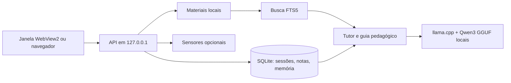

<p align="center"></p>

# Ritmo

**Estudo com foco, material à mão e progresso que você consegue conferir.** O Ritmo reúne matérias, sessões, anotações, leitura de arquivos e um tutor executado no próprio computador.

[Fluxo](#fluxo) · [Recursos](#recursos) · [Arquitetura](#arquitetura) · [Executar](#executar) · [Dados](#dados) · [Roadmap](#roadmap) · [Origem](#origem)

## Fluxo

Em uma sessão de estudo:

1. Escolha ou crie uma matéria e defina uma meta semanal.
2. Inicie o foco, abra um PDF, DOCX ou TXT e encontre o trecho que precisa.
3. Anote o que aprendeu e, se quiser, converse com o tutor sobre o material selecionado.
4. Pause, retome e conclua. Só os intervalos de foco entram no tempo estudado.
5. Consulte a evolução, o histórico e as revisões pessoais que registrou.

A matéria e a tela escolhidas são lembradas ao reabrir. Uma sessão em andamento volta do banco local.

## Recursos

| Recurso | Estado | O que existe hoje |
| --- | --- | --- |
| Matérias, metas, foco, pausa, notas e evolução | **Disponível** | Interface e persistência SQLite, com correções de tempo registradas. |
| Leitor de PDF, DOCX e TXT | **Disponível** | Extração de texto, busca, seleção e notas com referência ao trecho. |
| Backup e restauração manual | **Disponível** | ZIP com banco, materiais originais e configuração, quando houver. |
| Tutor por matéria e sessão | **Em validação pedagógica** | Dúvidas, aula guiada, histórico, busca FTS5 e referências funcionam; respostas reais ainda têm falhas de didática e fundamentação. |
| IA local | **Disponível** | Qwen3 GGUF servido por llama.cpp no computador, instalado por ação explícita. |
| Portabilidade da IA e sensores | **Em validação** | O pacote CUDA e o fluxo Windows foram testados; outros computadores, câmera física e permissões exigem verificação. |
| Atualizações acadêmicas e de trabalho | **Em validação** | Cadastro manual e versionado de resumos de fontes oficiais; a conferência do conteúdo cabe ao usuário. |
| Ajuste de pesos e atualização automática de fontes | **Planejado** | Há um pipeline experimental, mas nenhum adaptador foi treinado ou integrado. |

Os sensores de janela, ociosidade e presença começam **desligados**. A câmera é opcional. Tempo de foco e imagem não são usados para deduzir emoção, inteligência ou capacidade.

## Arquitetura



O tutor recebe a pergunta, até 12 mensagens recentes e até seis trechos recuperados dos materiais marcados para a matéria. O modelo não tem ferramenta para executar comandos, instalar programas, ler arquivos arbitrários ou publicar dados.

## Executar

### Desenvolvimento no Windows

Requisitos: **Python 3.11**, Windows e **WebView2** para a janela própria. No PowerShell, dentro da raiz deste repositório:

```powershell
py -3.11 -m venv .venv
.\.venv\Scripts\python.exe -m pip install -r requirements-desktop.txt -r requirements-windows.txt
.\.venv\Scripts\python.exe desktop.py
```

O código também pode servir a interface em `http://127.0.0.1:8765` com `.\.venv\Scripts\python.exe main.py serve`. Esse modo não abre a janela própria.

Em **Configurações → Tutor local**, escolha o modelo e a pasta de instalação. Os pesos e o runtime são baixados **somente** após clicar em **Instalar modelo escolhido**. O catálogo [local_ai/models.json](local_ai/models.json) fixa versões, tamanho e SHA-256. Há duas opções: Qwen3 4B Q4_K_M (padrão) e Qwen3 1.7B Q8_0. Reserve espaço para pesos, runtime e pelo menos 1 GB adicional. O build do runtime incluído no catálogo é Windows CUDA 12.4; confira sua compatibilidade antes de instalar.

### Pacote Windows

O repositório distribui **código**, não um executável pronto. Para gerar e instalar um pacote local, execute:

```powershell
powershell -NoProfile -ExecutionPolicy Bypass -File scripts/build_windows.ps1
```

O script cria `.buildvenv`, empacota com PyInstaller, testa o executável com dados temporários, instala a pasta do aplicativo e atualiza um atalho na Área de Trabalho. O pacote não é assinado. Esse comando altera a instalação local; o fluxo de desenvolvimento acima não exige executá-lo.

## Dados

No desenvolvimento, o banco fica em `storage/ritmo.db` e as preferências locais em `config/local.json`. No pacote Windows, ficam em `%LOCALAPPDATA%\Ritmo`: banco, materiais originais, log, configuração e backups. Os modelos são mantidos em uma pasta escolhida **fora do repositório e da pasta de dados**. [config/local.example.json](config/local.example.json) mostra uma configuração sem credenciais.

**Criar backup** produz um ZIP com uma cópia SQLite consistente, os materiais e a configuração, se existir. Pesos e runtime não entram no ZIP. Para restaurar, feche o aplicativo, guarde uma cópia da pasta atual e restaure o conteúdo do ZIP antes de abrir novamente.

Depois da instalação dos pesos, perguntas ao tutor são processadas localmente em `127.0.0.1`, sem chave da OpenAI e sem cobrança por chamada. A instalação **explícita** dos modelos usa downloads HTTPS das fontes indicadas no catálogo. O aplicativo não envia automaticamente materiais, notas ou conversas para uma API externa. Uma chave DPAPI de versões antigas, se existir, não é usada pelo tutor atual.

## Limites

- PDFs digitalizados sem camada de texto ficam sem conteúdo extraível; não há OCR.
- O modelo pode errar ou citar um trecho de forma inadequada. Abra a referência para conferir o original. Sem trecho relevante, a resposta deve indicar que não está baseada no material.
- A primeira resposta pode demorar enquanto o modelo carrega. Falta de pesos, memória ou compatibilidade não bloqueia o estudo manual.
- O suporte foi verificado em um computador Windows com GPU NVIDIA compatível com o runtime incluído. Não há validação geral de CPU, outras GPUs ou outros sistemas.
- Os [ensaios locais](docs/benchmark-local.json) e as [medições de velocidade](docs/benchmark-speed.json) usam poucos casos sintéticos; não demonstram precisão geral.
- A [avaliação do tutor com modelos reais](docs/tutor-evaluation.md) executou nove cenários sintéticos no Qwen3 4B e 1.7B, antes e depois de ajustes no guia e no contexto. O 4B esperou a tentativa na abertura após o ajuste; o 1.7B ainda antecipou a solução. Ambos corrigiram uma tentativa parcialmente errada e ignoraram uma instrução hostil em um TXT neste ensaio. Citações no corpo e respostas sobre dados atuais sem fonte continuam problemáticas. Consulte respostas, pontuações, tokens e `timings` antes de confiar num resultado.
- Informações sobre cursos e mercado não são atualizadas automaticamente. Um resumo cadastrado manualmente precisa de fonte, data, escopo e revisão humana.

## Roadmap

As fases descrevem **código entregue** e o que ainda precisa ser medido. Busca em documentos, memória e instruções do tutor não são treinamento dos pesos.

### Fase A — Base do aplicativo

**Estado:** disponível. Sessões, foco e pausa, matérias, materiais, notas, evolução, migrações e backup têm implementação e testes. **Próximo:** ampliar testes de restauração e de uso prolongado. **Dependência:** bancos de teste sintéticos. **Aceite:** migração e restauração preservam contagens e `PRAGMA integrity_check=ok`.

### Fase B — Tutor de estudos

**Estado:** interface e fluxo disponíveis, qualidade pedagógica em validação. Chat por matéria/sessão, dúvida, aula guiada, seleção de materiais, busca de trechos e referências estão no código. O [ensaio reproduzível](docs/tutor-evaluation.md) incluiu respostas reais locais dos dois Qwen3 e avaliação manual, além dos testes com provedor controlado; nenhuma chamada atual usa a API OpenAI. **Próximo:** impedir antecipação da solução no 1.7B, conter afirmações atuais sem fonte e ampliar casos contraditórios. **Dependência:** conjunto revisado de perguntas e materiais sintéticos. **Aceite:** referência correta no texto e no painel, uma pergunta sem resposta na abertura e nenhuma estatística ou disponibilidade oficial inventada.

### Fase C — IA local

**Estado:** disponível no Windows testado; portabilidade em validação. CPU, GPU, RAM e disco foram levantados, os dois modelos do catálogo foram medidos, o processo llama.cpp é gerenciado pelo aplicativo e um fluxo sem Internet e sem chave foi testado. **Próximo:** testar instalação e latência em outras máquinas, inclusive sem a GPU usada no ensaio. **Dependência:** hardware de teste e espaço em disco. **Aceite:** conversa real offline, processo encerrado ao sair, porta liberada e tempo/RAM/VRAM registrados por máquina.

### Fase D — Orientação de estudos

**Estado:** parcial. O guia pedagógico, a recuperação de trechos e as revisões pessoais explícitas estão disponíveis; o usuário pode consultar, editar, exportar e apagar cada revisão. Os intervalos de 1, 3 e 7 dias são sugestões, não medida de domínio. **Próximo:** avaliar planejamento, prática de recuperação e feedback com fontes licenciadas e usuários de teste, sem inferir características pessoais dos sensores. **Dependência:** critérios pedagógicos e revisão das fontes. **Aceite:** recomendações explicam sua evidência e correções explícitas do estudante permanecem sob seu controle.

### Fase E — Avaliação e eventual ajuste

**Estado:** planejado. [training/](training/) contém exemplos sintéticos e um pipeline QLoRA com limite mínimo de corpus; **nenhum ajuste de pesos foi executado**. **Próximo:** ampliar e revisar os conjuntos de preparação e teste, medir o modelo base e só então decidir se um adaptador ajuda. **Dependência:** licença dos dados, avaliação separada e hardware suficiente. **Aceite:** resultados reproduzíveis mostram melhora sem piorar fundamentação, segurança, latência e consumo; o teste não participa do treino.

### Fase F — Informação acadêmica e carreira

**Estado:** parcial. O catálogo de fontes e o cadastro manual de atualizações datadas estão disponíveis; integração automática não existe. **Próximo:** definir rotina de revisão de INEP/MTE e outras fontes pertinentes, com licença, data e escopo. **Dependência:** publicações oficiais e permissão de uso. **Aceite:** toda afirmação atual mostra fonte e período; orientação geral fica separada de estatísticas observadas, tendências e previsões, sem prometer resultado profissional.

Também está pendente decidir e registrar uma licença **própria** para o Ritmo. O arquivo [LICENSE](LICENSE) preserva os termos registrados no WorkWatch de origem; não foi criada uma licença nova nesta separação.

## Capturas de tela

Ainda não há capturas no repositório. Elas serão produzidas com banco e materiais **sintéticos**, para não expor estudos, conversas ou caminhos pessoais.

## Origem

O Ritmo nasceu no [WorkWatch](https://github.com/Dinox75/WorkWatch). Este repositório independente foi preparado a partir do checkout local `feat/ritmo-local-tutor`, commit `30df089`, sem alterar o histórico do WorkWatch. O primeiro commit aqui registra a separação; não representa desenvolvimento do zero. A atribuição e o aviso de direitos originais foram preservados em [LICENSE](LICENSE).

## Testes e contribuição

```powershell
.\.venv\Scripts\python.exe -m pip install -r requirements-qa.txt
.\.venv\Scripts\python.exe -m unittest discover -s tests -q
```

Os testes cobrem banco e migrações, sessões, notas, materiais, busca, tutor, memória, backup e fluxos de interface com Edge/Playwright. Para contribuir, descreva o cenário, o resultado esperado e o teste que o reproduz. Use somente dados sintéticos em issues, capturas e fixtures.

<details>
<summary>O tutor funciona sem Internet?</summary>

Sim, **depois** da instalação explícita dos pesos e do runtime. O download inicial exige conexão. O processo de inferência é local e termina ao fechar o Ritmo.

</details>
