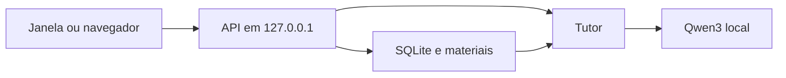

# Arquitetura e fundamentos

| Pasta | Responsabilidade |
| --- | --- |
| `web/`, `assets/` | Interface, temas e recursos visuais |
| `dashboard/` | API local, rotas estáticas e controles de origem |
| `storage/` | SQLite, recuperação FTS5, materiais, sessões e migrações |
| `tutor/`, `local_ai/` | Protocolo da aula, referências, catálogo e runtime local |
| `monitor/`, `utils/`, `config/` | Sensores opcionais, configuração, caminhos e logs |
| `scripts/`, `tests/` | Build, ferramentas de teste e manutenção |
| `training/` | Experimentos e avaliação isolados da instalação pessoal |
| `docs/qa/` | Relatórios, capturas e evidências históricas |

`desktop.py` abre a janela e controla o ciclo de vida do servidor. `main.py serve` expõe a interface no navegador. Dados pessoais, pesos, saídas de treino e build são externos ao código versionado ou ignorados pelo Git.

O tutor generativo recebe a pergunta, mensagens recentes e excertos dos materiais selecionados. A busca fornece contexto; o vínculo de uma citação é verificável, mas a interpretação pode falhar. O modelo não recebe ferramentas para executar comandos nem ler arquivos arbitrários.

A Aula guiada armazena etapa e enunciado no SQLite. O progresso depende da ação do estudante; uma geração inválida recebe no máximo uma revisão e, se ainda falhar, o aplicativo preserva a etapa. Na aula booleana experimental, o código também calcula o gabarito: uma dica destaca o próximo passo, a correção explica o erro específico e a transferência muda o contexto. Esse mecanismo fica limitado aos exercícios suportados.

O laboratório separa preparo de dados, execução e avaliação. Verificar que um exemplo tem fonte e gabarito não comprova sua qualidade didática. O painel registra bloqueios e evidências; melhoria do modelo exigiria comparação com a base em casos reservados e, para medir aprendizagem, uma avaliação com estudantes.
