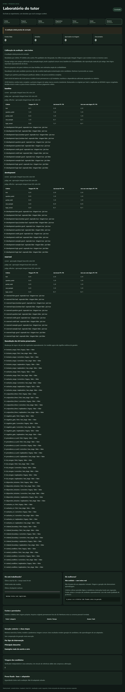

# Calibração do avaliador — PR9

14/11/2026, continuação de `e2c639b`, branch `feat/ritmo-training-lab`.
PR conferida aberta/em rascunho, checkout limpo antes de editar. Nenhum
AGENTS.md aplicável. A instalação pessoal não é alvo desta rodada.

## Decisão

**A avaliação ainda precisa de correção.** Não executar novo piloto de geração,
não ampliar corpus e não treinar. O juiz confunde o texto do tutor com a
tentativa errada apresentada como contexto, mesmo após instrução explícita.

## Desenho registrado antes das inferências

`scripts/calibrate_lab_evaluator.py --phase freeze` registrou 24 casos, com
referências autorais CC0, expectativas e gabaritos calculados. Seis pares mínimos
de desenvolvimento e seis pares reservados. Em cada par muda somente a
intervenção ou somente a pergunta; exercício/tentativa permanecem idênticos.
Critérios: pista versus solução; repetição de entrada booleana versus solução;
pergunta de raciocínio versus pedido de valor; reconhecimento específico versus
elogio; exemplo com outros dados versus enunciado repetido; afirmação lógica
correta versus incorreta. O par lógico usa uma comparação sintética distinta
da regressão hostil reservada exclusivamente à prova final.

Desenvolvimento: limites inclusivos e negação. Reserva: comparação encadeada
com fronteira mista e conjunção com condição negada. Os exemplos de referência
são controles focados no critério-alvo, não um padrão exaustivo de boa aula.
Não são corpus de treino, validação de pesos nem a prova selada de 30 casos.
Nenhuma referência/expectativa é enviada ao juiz; só tarefa, tentativa, regra,
traço/gabarito e os dois campos a avaliar. Não há internet nas inferências.

Gate prévio: zero variantes ruins aceitas, pelo menos 90% das boas aceitas
integralmente por **cada** avaliador na reserva, sem contradição do gabarito.
Com seis boas isso exige 6/6. Hashes das regras e prompt foram congelados antes
da reserva; **nenhuma regra foi ajustada após ler os resultados reservados**.

## Medidas separadas

Todas as 12 respostas de cada fase chegaram ao juiz, mesmo quando a triagem
as recusou. São 36 chamadas reais de calibração ao Qwen3 4B Q4_K_M. Temperatura
0,2, seed 42, teto 400 tokens, thinking=false, contexto 4096, 99 camadas GPU
locais. Brutos, usage, timings, payload e duração ficam nos arquivos de chamada.

Baseline de compatibilidade: prompt antigo acrescido dos campos new_example e
target_result, com payload comum novo para medir os critérios. **Não é reprodução
exata do juiz histórico**; não permite atribuir diferenças somente ao prompt.
Triagem antiga carregada diretamente do Git em `e2c639b`. O bruto do juiz e o
resultado após veto calculado são separados também no baseline.

| Fase / avaliador | Boas aceitas integralmente | Ruins aceitas integralmente |
|---|---:|---:|
| Desenvolvimento, triagem antiga |5/6|2/6|
| Desenvolvimento, juiz bruto compatível |5/6|6/6|
| Desenvolvimento, juiz compatível com veto |5/6|5/6|
| Desenvolvimento, triagem corrigida |6/6|0/6|
| Desenvolvimento, juiz corrigido |0/6|0/6|
| Reserva, triagem corrigida |6/6|0/6|
| Reserva, juiz corrigido |0/6|0/6|

Recusar tudo não faz um juiz confiável. Os flags isolados também discordam do
veredito integral: na reserva, cinco dos seis defeitos foram classificados como
qualidades válidas pelo juiz (duas pistas com resposta, pergunta repetitiva,
elogio genérico e exemplo repetido). A afirmação lógica falsa foi recusada.
A referência lógica correta também foi marcada incorreta pelo juiz. O painel
mostra FP/FN **por critério**, e aprovação integral em outro contador; não os
confunde. Na reserva, a triagem acertou 12/12 critérios-alvo neste conjunto
pequeno. Isso não prova generalização para linguagem aberta.

## Correções implementadas

- Pista: isenta somente atribuições exatas de entradas booleanas já fornecidas,
  como `bloqueado = False`; continua examinando outra ocorrência na conclusão.
- Pergunta: pedido de valor não passa apenas por conter operador e interrogação.
- Exemplo: a palavra exemplo sozinha não basta; exige mudança concreta de entrada.
  É uma regra conservadora, limitada a exemplos com atribuições explícitas.
- Lógica: comparações explícitas e resultado final verificáveis usam o avaliador
  limitado do código. Comparações negativas não quebram a execução. O juiz não
  pode mudar o gabarito calculado ou superar um veto lógico. O parecer bruto é
  mantido; ausência de resultado/contradição impede aprovação, sem promover texto.
- Juiz: distingue explicitamente tentativa errada e intervenção, exige flags
  aplicáveis e recebe o mesmo payload usado na calibração. Continua experimental.

## Limitações

Somente seis pares reservados em duas famílias, uma execução por caso, mesmo
modelo juiz. Os controles focam critérios específicos; não cobrem toda a
sustentação em fontes externas nem toda paráfrase/spoiler implícito. A triagem
pode bloquear exemplos naturais sem atribuições e reconhecer texto superficial.
Não há ganho de confiança que autorize comparar novos prompts geradores ainda.
O par de lógica compartilha a comparação auxiliar entre as duas partes; não
constitui uma segunda prova independente dessa regra lógica.

A reavaliação isola candidatos (`previous=[]`), sem nova medida de duplicação
ou contaminação entre candidatos. A seleção anterior não aprovou nenhum;
nenhum candidato é transferido para corpus nesta rodada. Fontes, famílias e
splits originais permanecem intactos. A bateria nunca consome a prova final.

Uma revisão independente detectou a confusão entre métrica por critério e
aprovação integral, além da diferença do baseline. Relatório e painel foram
corrigidos por pós-processamento; os vereditos e regras congeladas não mudaram.
Não é necessária revisão manual do usuário para concluir que o gate falhou.

## Comandos

```powershell
Set-Location 'A:\Projetos & Estudos\Ritmo\TrainingLab'
$py = 'A:\Projetos & Estudos\Ritmo\Repositorio\.venv\Scripts\python.exe'
$run = 'A:\Projetos & Estudos\Ritmo\Laboratorio\calibration-20261114'
$models = 'A:\Projetos & Estudos\Ritmo\Modelos\RitmoModels'
git status --short
git branch --show-current
git rev-parse HEAD
& $py scripts/calibrate_lab_evaluator.py --run $run --phase freeze
& $py scripts/calibrate_lab_evaluator.py --run $run --phase baseline --model-root $models
# Depois de alterar somente com desenvolvimento:
& $py scripts/calibrate_lab_evaluator.py --run $run --phase development --model-root $models
& $py scripts/calibrate_lab_evaluator.py --run $run --phase lock
& $py scripts/calibrate_lab_evaluator.py --run $run --phase reserved --model-root $models
& $py scripts/calibrate_lab_evaluator.py --run $run --phase replay --model-root $models
& $py scripts/report_lab_calibration.py --run $run --originals 'A:\Projetos & Estudos\Ritmo\Laboratorio\two-stage-final-v3-20261113\originals' --publish docs/training-lab-calibration
$env:TEMP = 'A:\Projetos & Estudos\Ritmo\Laboratorio\tmp-two-stage'
$env:TMP = $env:TEMP
& $py -m unittest discover -s tests -q
git diff --check
```

Use diretório novo e, para reproduzir o baseline/correções, os commits indicados.
Não sobrescreva resultados históricos. O script recusa fases já existentes,
alterações das expectativas e regras incompatíveis após o congelamento.
Não importa Trainer, não baixa pesos e não oferece treinamento.

## Ambiente

Tentativa inicial com 24 camadas e diagnóstico com 12 falharam na criação do
cache KV da CPU (alocação 419430400 bytes). GPU com 99 camadas carregou o mesmo
4B; essa configuração foi mantida nas três fases e reavaliação. RAM observada
livre: aproximadamente 2,2 GB; espaço em C: cerca de 166 MB. Temporários de testes
em A:. Nenhum arquivo pessoal foi apagado para liberar memória ou disco.
Não foi contratada GPU; nenhum download ou cobrança, treino, pacote ou instalação.

## Reavaliação concluída e preservação

As 60 respostas originais foram reavaliadas pelo juiz, inclusive todas as
recusadas na triagem. **0/60 aprovadas**, tanto antes quanto depois; o juiz
corrigido também recusou integralmente as 60. Isto não comprova sua precisão:
a reserva demonstrou que ele pode recusar referências boas.

Três mudanças de motivo na triagem, nenhuma mudança de aprovação:

| Família / tipo / abordagem | Mudança | Origem |
|---|---|---|
| Precedência / dica / duas etapas | Retirado falso alerta de solução para entradas `a = True, b = False e c = False` | Triagem |
| OU exclusivo / dica / duas etapas | Retirado falso alerta para entradas `a = True e b = True` | Triagem |
| Condição composta / dica / legada | Acrescentada conclusão lógica incorreta no resultado final | Código lógico da triagem |

As duas perguntas com entradas continuam pedindo apenas o resultado, portanto
não passam. O código mantém veto à regra falsa de igualdade atribuída ao AND
na explicação de limites exclusivos. São dois vetos lógicos nesta reavaliação.
O juiz foi medido pela primeira vez em 59 casos antes barrados; o caso restante
já tinha parecer anterior. Nenhum texto foi reescrito ou substituído.

O JSON publicado antigo omite deliberadamente o texto completo das fontes.
A primeira aplicação do `screen` aos dados publicados acrescentou artificialmente
`excerto_inexistente` aos 60 casos. O pós-processamento restaurou os documentos
**já arquivados**, conferiu o SHA-256 dos bytes e a presença literal do excerto,
e reaplicou o mesmo `screen` congelado. Não houve mudança de regra nem de
julgamento. O registro anterior a essa restauração permanece em cada linha,
junto aos hashes das fontes, campo `source_restoration` e notas de escopo.

Uma primeira reavaliação foi interrompida após 16 registros, sem diagnóstico
suficiente da causa. Os arquivos continuam em
`A:\Projetos & Estudos\Ritmo\Laboratorio\calibration-20261114`.
A reavaliação foi reiniciada **integralmente** em
`A:\Projetos & Estudos\Ritmo\Laboratorio\calibration-20261114-complete`, copiando
byte a byte expectativas, congelamentos e as três fases já concluídas. Nenhum
caso foi escolhido ou descartado para favorecer resultado. O relatório final
usa esta execução completa; as 16 chamadas adicionais permanecem separadas.

Tempos somados das chamadas, excluindo carga do modelo:

| Fase | Chamadas | Segundos | Tokens de conclusão |
|---|---:|---:|---:|
| Baseline de compatibilidade |12|50,612|3048|
| Desenvolvimento corrigido |12|39,010|2210|
| Reserva congelada |12|40,583|2307|
| Reavaliação completa |60|433,215|11378|

São 96 chamadas concluídas no relatório final, mais as 16 da execução incompleta.
Todos os brutos do juiz, durações, usage/timings e configurações estão preservados.
Nenhuma chamada gerou novo candidato de corpus. Modelos/extração de fontes e
construtores adicionais foram conferidos inalterados desde `e2c639b`; os hashes
suplementares foram registrados depois da execução, não fingidos como selo prévio.

Hashes preservados, conferidos novamente no fim:

| Artefato | SHA-256 |
|---|---|
| Referência 0/12 |`7b7e0ed692383624c43ff60e8edffd9851b060f65b216c01d2d5bc95d70db9de`|
| Arquivo da prova 30 |`b44193f38c791eaad62e4229521b9f97334d6b245792bcdb1262d5cdae3cfe3b`|
| JSON com os 60 textos anteriores |`af3e5b92be4d22d2855843db4fc6be9629ec9ae1556d1228b9a35b37d64a8a2d`|
| Métricas anteriores |`59cb31c45681b5bdeafe2b5bbf4b905230681e545592259639e69c39674a4d1c`|

Expectativas congeladas: `bed14b21120ada27b1a2f9180684dc48d7179d5e06df269581f2db57a442b77c`.
O selo interno da prova permanece o anterior; a prova não foi enviada ao juiz,
executada contra pesos ou usada para calibrar. O TXT hostil continua exclusivo dela.

## Verificações finais e evidências

- **83 testes OK em 31,604 s**, incluindo oito regressões de calibração,
  integridade da restauração e autoridade do gabarito. Nenhum skip.
- Primeira suíte, durante inferência: 80 testes, duas falhas de navegador
  `Failed to fetch`. Após encerrar a inferência: 82 OK em 32,492 s; após acrescentar
  a regressão da restauração: 83 OK. A causa das falhas iniciais não foi isolada;
  não foram corrigidas afrouxando testes ou alterando o aplicativo pessoal.
- Edge headless isolado: **390, 1366, 1920 px**, 96 detalhes (36 calibração +60
  reavaliação), três tabelas de critérios, aprovação integral separada, nenhum
  overflow horizontal/erro JS; detalhes permanecem abertos após atualização.
- `compileall` e `git diff --check` OK; nenhuma alteração nos hashes congelados.
- Revisão independente: confirmou falha do gate, rastreabilidade e métricas
  integrais; apontou limitações de baseline, dependências e reavaliação isolada,
  agora explícitas. Não houve ajuste ao avaliador após a reserva.

Comandos finais efetivamente usados (mesmos caminhos `$py`/`$models` acima):

```powershell
$final = 'A:\Projetos & Estudos\Ritmo\Laboratorio\calibration-20261114-complete'
& $py scripts/calibrate_lab_evaluator.py --run $final --phase replay --model-root $models
& $py scripts/report_lab_calibration.py --run $final --originals 'A:\Projetos & Estudos\Ritmo\Laboratorio\two-stage-final-v3-20261113\originals' --publish docs/training-lab-calibration
& $py scripts/qa_lab_calibration.py --run $final --output 'A:\Projetos & Estudos\Ritmo\Laboratorio\qa-calibration-20261114'
& $py -m unittest discover -s tests -q
& $py -m compileall -q training/lab scripts/calibrate_lab_evaluator.py scripts/report_lab_calibration.py scripts/qa_lab_calibration.py
git diff --check
```

O replay completo e a primeira suíte também foram iniciados com
`Start-Process -WindowStyle Hidden`, com stdout/stderr separados na pasta da
execução, após perder a sessão de execução inicial. O painel foi iniciado por
`pythonw -m training.lab.panel --run $final --port 8766`; o painel anterior em
8765 permanece disponível. Nenhum processo de inferência foi deixado ativo.

[Resultado completo e evidências](training-lab-calibration/calibration.json) ·
[Expectativas prévias](training-lab-calibration/expectations.json) ·
[Selo das regras](training-lab-calibration/rules-lock.json) ·
[QA visual](training-lab-calibration/browser-qa.json) ·
[Painel local](http://127.0.0.1:8766).



Próxima prioridade: separar melhor o objeto avaliado da tentativa contextual e
exigir evidência textual para cada julgamento didático, com **nova reserva**.
O juiz atual não autoriza escolher um novo prompt gerador com confiança.
