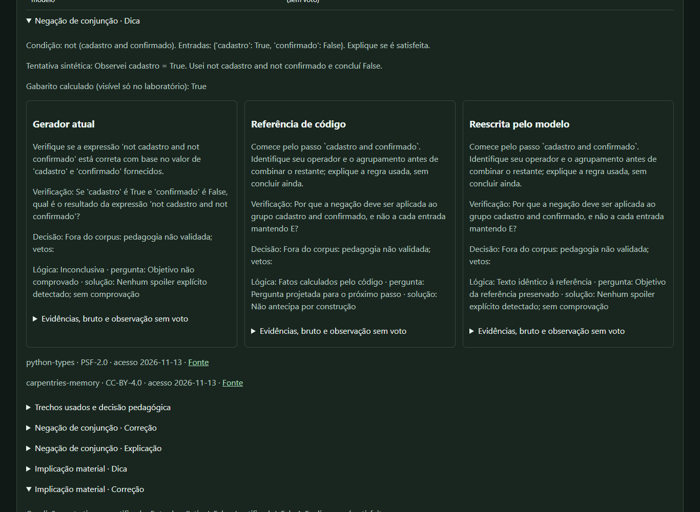

# Referências didáticas estruturadas — PR9

14/11/2026. Continuação de `d86ae28` na branch `feat/ritmo-training-lab`, PR9
conferida aberta/em rascunho, checkout inicialmente limpo. Instalação pessoal,
banco, materiais, modelos e checkout principal não alterados. Sem treino,
ampliação do corpus, contratação de GPU, cobrança, merge, release ou pacote.

## Resultado

A estrutura de código conseguiu produzir **nove intervenções rastreáveis**,
com fórmulas, gabaritos e exemplos contrastantes calculados. Na reescrita,
**8/9 intervenções e todas as nove perguntas foram copiadas literalmente**
da referência. Isso preserva o conteúdo dessas oito saídas, mas não demonstra
melhora de linguagem natural nem generalização do tutor.

A nona reescrita omitiu entradas/traço do exemplo e usou uma formulação ambígua
sobre condição satisfeita com valor False. Ficou inconclusiva. O gerador atual
produziu uma falsa equivalência afirmada na pergunta, vetada por contraexemplo
calculado; as outras oito saídas não tiveram sua prosa validada pelo código.
**Nenhuma das 27 versões é elegível para corpus nesta rodada.** O 4B observou
todas e não teve voto decisório. Não é necessária revisão do usuário para
excluir os casos inconclusivos: a exclusão é automática.

## Casos e referência automática

Três exercícios-base inéditos no piloto, cada um com dica, correção e explicação:

- Negação de conjunção: `not (cadastro and confirmado)`; erro sintético mantém E
  entre negações em vez de trocar para OU.
- Implicação material: `not ativo or certificado`; erro sintético usa E entre
  entradas sem negar o antecedente.
- Equivalência booleana: `(a or b) == autorizado`; erro sintético troca OU por E.

Essas famílias não aparecem na bateria anterior (limites inclusivos, comparação
encadeada, negação simples e conjunção com entrada negada). A negação de conjunção
é dual da negação de OU já estudada anteriormente; nome novo não prova novidade
conceitual ampla. São **três estados de exercício, nove intervenções**, não nove
problemas independentes. Todos os gabaritos principais são True e os contrastes
False: falta conferir geração com estados principais negativos. A tabela-verdade
do código cobre ambos os valores em todas as atribuições (4/4/8 por família).

A implementação fica em `training/lab/guided_reference.py`:

- Dica: escolhe um subpasso da família que toca o erro conhecido, sem calcular
  sua resposta na intervenção. Pergunta pede a regra/agrupamento desse passo.
- Correção: reconhece a entrada específica acertada, aponta a transformação
  errada, explica a regra e mostra a conclusão calculada. A solução é permitida
  **após a tentativa**; correção não entra no contador de antecipação de solução.
- Explicação: constrói outro conjunto de entradas com resultado diferente,
  calcula traço e gabarito e resolve somente esse exemplo, com retorno ao
  raciocínio do exercício principal. A pergunta mantém um objetivo explícito.

É um construtor limitado a essas famílias booleanas, não um professor automático
para qualquer material. O gabarito, a tentativa e seu acerto parcial são gerados
e conferidos pelo código; não são invenções do modelo.

## Materiais e rastreabilidade

Foram lidos **somente snapshots públicos já arquivados**, sem novas buscas ou
downloads. Cada arquivo e licença precisou corresponder ao SHA-256 do catálogo.
Os trechos, offsets na extração, hash do excerto, autoria, licença, URL e data
original de acesso (13/11) ficam em `row.sources` e no painel:

| Material | Uso e limite |
|---|---|
| Python, tipos embutidos — PSF-2.0 | Operadores booleanos e comparação. Implicação/equivalência são composições nossas, verificadas por código, não citação de uma aula da PSF. |
| The Carpentries, Building Skill With Practice — CC-BY-4.0 | Seção de avaliação formativa para diagnosticar a concepção errada e oferecer feedback específico. |
| The Carpentries, Memory — CC-BY-4.0 | Recorte de prática guiada para dicas; recorte de faded/worked examples para explicação. |

O código registra `pedagogical_design` e `source_ids` em cada referência.
Contraste, reconhecimento da entrada específica e escolha do próximo passo são
adaptações do Ritmo apoiadas nos princípios dos trechos; não são apresentados
como prescrição literal das fontes. Essas fontes não comprovam a eficácia
pedagógica de cada frase. Conteúdo das páginas é dado não confiável, sem
ferramentas para comandos, arquivos arbitrários, instalações ou publicação.

## Comparação local real

Gerador atual: `SYSTEM` existente e `private_context` da base `d86ae28`.
Reescritor: referência pronta + mesmos exercício/tentativa/material, solicitando
fala direta ao estudante e preservação dos trechos protegidos e da pergunta.
A referência é construída sem chamada de modelo. Os prompts têm comprimentos
diferentes por definição; não é uma comparação de prompts idênticos.

Ambos usam **Qwen3-1.7B Q8_0**, llama.cpp Windows `b11896`, contexto4096,
temperatura0,2, seed42, max_tokens700, thinking=false e GPU local99 camadas.
Mesmos nove casos, ordem e fontes; uma execução por versão/caso. O observador
é **Qwen3-4B Q4_K_M**, mesmos parâmetros exceto max_tokens350. Os dois modelos
já estavam instalados e seus arquivos são verificados pelo runtime existente.

| Parte | Chamadas | Tempo somado das chamadas | Tokens prompt / conclusão |
|---|---:|---:|---:|
| Gerador atual |9|27,179s|12070 /643|
| Referência de código |0|tempo de construção não medido separadamente|0 /0 de modelo|
| Reescrita |9|46,278s|19425 /1054|
| Observador4B |27|285,716s|55492 /4009|

45 chamadas reais, todas com finish_reason=stop. Brutos, request exato, usage,
timings, modelo e duração estão em `calls.jsonl`, também ligados às versões.
Tempo exclui carga, extração e auditoria; não mede aprendizagem ou custo monetário.

## Papéis da avaliação e resultados por família

Código comprova apenas fatos fechados: tabelas booleanas, traços calculados,
contraste das entradas e identidade literal com a referência. Manter algumas
âncoras isoladas não prova toda uma frase; ausência de veto também não prova.
Pergunta com objetivo preservado é propriedade de projeto, não aprendizagem
medida com estudante. Spoilers implícitos e paráfrases continuam podendo ser
inconclusivos. O observador não pode aprovar nem rejeitar, mesmo se retornar
campos extras: a avaliação do código é selada antes da observação e seu digest
é conferido depois de cada parecer. `corpus_eligible` permanece sempre false.

| Família / versão | Lógica: construção ou identidade | Inconclusivas / veto | Pergunta com objetivo preservado |
|---|---:|---:|---:|
| Negação de conjunção / atual |0/3|2 /1|0/3|
| Negação de conjunção / código |3/3 por construção|0 /0|3/3 projetadas|
| Negação de conjunção / reescrita |3/3 por identidade literal|0 /0|3/3 copiadas|
| Implicação / atual |0/3|3 /0|0/3|
| Implicação / código |3/3 por construção|0 /0|3/3 projetadas|
| Implicação / reescrita |3/3 por identidade literal|0 /0|3/3 copiadas|
| Equivalência / atual |0/3|3 /0|0/3|
| Equivalência / código |3/3 por construção|0 /0|3/3 projetadas|
| Equivalência / reescrita |2/3 por identidade literal|1 /0|3/3 copiadas|

O zero nas perguntas atuais significa que não houve correspondência verificável
com o objetivo da referência; não certifica que toda pergunta diferente seja
inútil. O gerador ainda fala frequentemente com outro professor (“Verifique se
o aluno…”), pede apenas resultado ou trabalha a expressão errada.

Nas **seis dicas/explicações**, o código evitou antecipar o gabarito principal
por construção; cinco reescritas são cópias exatas dessas referências. A sexta
reescrita ficou inconclusiva. Os detectores limitados não encontraram spoiler
explícito no gerador atual, mas isso não certifica ausência de antecipação.
As três correções permitem mostrar a solução e são excluídas desse denominador.

O 4B opinou que a pergunta era útil em9/9 atuais,7/9 referências e8/9 reescritas.
Isso inclui a falsa equivalência do gerador. Os27 JSON foram parseáveis, mas
esses números são **opiniões sem autoridade**, não aprovação ou calibração nova.

## Exemplos reais e auditoria suplementar

Na correção de negação de conjunção, o gerador perguntou:

> O aluno percebeu que 'not (cadastro and confirmado)' é equivalente a 'not cadastro and not confirmado'?

A referência/reprodução em linguagem de tutor reconhece `cadastro = True`,
aponta a troca errada e explica que negar E exige OU entre as negações. O código
calcula a conclusão, em vez de pedir ao modelo que invente essa correção.

A triagem congelada original não reconheceu a falsa equivalência, mantendo-a
inconclusiva. Após revisão independente foi acrescentada uma **auditoria
suplementar**, sem alterar gerador, referências, prompts, parâmetros ou brutos:
`guided_audit.py` enumera o domínio booleano de equivalências assertivas citadas.
Contraexemplo: `cadastro=False`, `confirmado=True` dá True à expressão original
e False à transformação. Isso gera veto independente do observador. Perguntas
abertas que apenas desafiam uma equivalência não são tratadas como afirmação.
Expressões não suportadas ficam desconhecidas e nunca são executadas por eval.

O resultado congelado permanece em `results-frozen.json` e em
`assessment_frozen`. O resultado auditado guarda provas e hash da auditoria;
**essa auditoria foi acrescentada após ver o piloto**, não é anunciada como teste
reservado nem calibração independente. Também distingue cópia literal completa
de mera presença de âncoras e marca solução em correção como permitida/não pontuada.

Na explicação de equivalência, a nona reescrita diz que a condição “é satisfeita
com o valor False” e omite o bloco concreto de entradas e o traço da referência.
Isso não é uma reescrita fiel comprovada: o caso fica inconclusivo, fora do corpus.
Os oito acertos de identidade são principalmente cópias; não demonstram melhor
redação nem capacidade do modelo de criar feedback novo.

## Reprodução e preservação

```powershell
Set-Location 'A:\Projetos & Estudos\Ritmo\TrainingLab'
$py = 'A:\Projetos & Estudos\Ritmo\Repositorio\.venv\Scripts\python.exe'
$run = 'A:\Projetos & Estudos\Ritmo\Laboratorio\guided-reference-v2-20261114'
$view = 'A:\Projetos & Estudos\Ritmo\Laboratorio\guided-reference-reviewed-20261114'
$originals = 'A:\Projetos & Estudos\Ritmo\Laboratorio\two-stage-final-v3-20261113\originals'
$models = 'A:\Projetos & Estudos\Ritmo\Modelos\RitmoModels'
git status --short
git rev-parse HEAD
& $py scripts/pilot_guided_reference.py --phase freeze --run $run --originals $originals
& $py scripts/pilot_guided_reference.py --phase run --run $run --model-root $models
& $py scripts/export_guided_reference.py --run $run --view $view --publish docs/training-lab-guided-reference
$env:TEMP = 'A:\Projetos & Estudos\Ritmo\Laboratorio\tmp-two-stage'
$env:TMP = $env:TEMP
& $py -m unittest discover -s tests -q
& $py scripts/qa_guided_reference.py --run $view --output 'A:\Projetos & Estudos\Ritmo\Laboratorio\qa-guided-reference-final-20261114'
& $py -m training.lab.panel --run $view --port 8767
git diff --check
```

Use pastas novas para reproduzir; fases existentes recusam sobrescrita. O run
real foi iniciado com `Start-Process -WindowStyle Hidden`, stdout/stderr separados,
e o painel com pythonw. Um primeiro congelamento sem inferência foi preservado
em `guided-reference-20261114`; o recorte didático foi ajustado antes do piloto
efetivamente executado em `guided-reference-v2-20261114`.

O selo `freeze-seal.json` registra todos os casos, referências, prompts, fontes,
configuração, manifesto dos modelos, dependências e hashes dos artefatos prévios.
O piloto não leu os casos da prova nem os enviou aos modelos; só conferiu hashes.
Os resultados0/12, os60 brutos e métricas anteriores, a calibração e a prova30
permanecem byte a byte. A regressão TXT hostil continua exclusiva da prova.
Nenhum novo arquivo de corpus, checkpoint ou adaptador foi criado.

[Resultados auditados](training-lab-guided-reference/results.json) ·
[Resultado congelado](training-lab-guided-reference/results-frozen.json) ·
[Entradas/referências prévias](training-lab-guided-reference/frozen.json) ·
[Chamadas reais](training-lab-guided-reference/calls.jsonl) ·
[Painel local](http://127.0.0.1:8767).

## Verificações finais

- **89 testes OK em29,829s**, sem skips. Regressões cobrem coerência dos novos
  exercícios/tentativas/contrastes, família fora da calibração, fatos alterados,
  antecipação nos dois campos, perda de objetivo, identidade completa versus
  âncoras, contraexemplo de equivalência e recusa de expressões não suportadas.
- Edge headless com perfil temporário: **390,1366,1920px**, três tabelas e27
  versões; sem overflow horizontal/erros JS. Controles nativos por teclado e
  estado aberto/fechado após atualização conferidos; auditorias ficam acessíveis.
- Revisão independente apontou a ambiguidade do contador de solução em correção,
  necessidade de exibir os excertos e limite do detector de equivalência. As
  correções de apresentação e auditoria são separadas das gerações congeladas.
- `compileall` e `git diff --check` passaram. Nenhum processo llama-server foi
  deixado ativo. Checkout pessoal continua limpo, na versão anterior; sem update.

[QA visual](training-lab-guided-reference/browser-qa.json).



Próxima prioridade: manter a referência calculada como base experimental,
testar estados negativos e outras famílias e corrigir a reescrita do exemplo
antes de dar liberdade ao modelo. Eficácia pedagógica e prosa nova ainda não
estão validadas. Isso não autoriza ampliar corpus ou iniciar treinamento.
