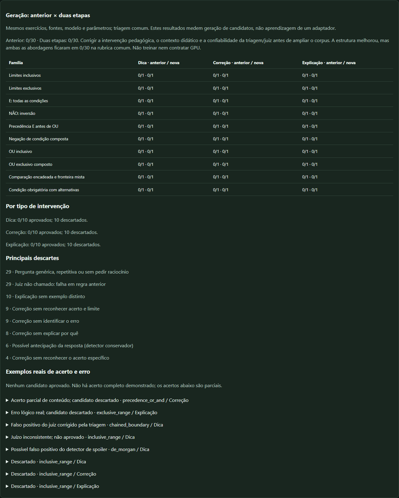

# PR9 — piloto local da geração em duas etapas

13/11/2026. Continuação de8d02ce1, na mesma branch feat/ritmo-training-lab.
**Sem treino, sem cobrança, sem adaptador e sem alteração do Ritmo pessoal.**
PR9 conferida aberta/em rascunho antes de editar; checkout limpo. Nenhum AGENTS.md
aplicável. A comparação inicial0/12 e a prova de30 casos permanecem intactas.

## Resultado e recomendação

**Corrigir a qualidade pedagógica e a confiabilidade da avaliação antes de ampliar
o corpus.** A estrutura de saída melhorou, mas a aprovação completa permaneceu
0/30 nas duas abordagens, usando uma rubrica comum. Nenhuma família produziu um
candidato aprovado; não há fundamento para contratar GPU ou treinar.

| Medida observada | Abordagem anterior | Duas etapas |
|---|---:|---:|
| Respostas reais do gerador |30|30|
| Pergunta extraível em campo próprio |1|30|
| Candidatos completos aprovados |0|0|
| Pergunta contextual reprovada pela triagem |30|29|
| Gabarito privado errado informado pelo modelo |8|não solicitado ao modelo|
| Exercício alterado ou sem preservação verificável |15|0|
| Tokens de conclusão |3069|2051|
| Tempo somado das chamadas de geração |108,020s|90,129s|
| Mediana por chamada de geração |3,592s|2,941s|

O gabarito novo é calculado pelo aplicativo: não é uma melhora de precisão lógica
do modelo. A diferença de tempo/tokens acompanha respostas mais curtas e não prova
didática melhor. As chamadas excluem carga do runtime; condições de cache/Windows
podem variar. Ambas usam Qwen3-1.7B Q8_0, temperatura0,2, seed42, teto700 tokens,
thinking=false, contexto4096 e os mesmos casos/excertos. Não são30 exercícios
independentes: são10 exercícios, cada um com dica, correção e explicação.

## O que mudou

`exercises.py` constrói os exercícios, resultados AST, tentativa parcial com um
fato correto e uma transformação lógica equivocada, e exemplo contrastante de
resultado diferente. Não recebe texto do modelo nem conteúdo da prova. O gerador
recebe o caso pronto e só pode produzir `intervention` e `verification_question`.
Na dica o resultado-alvo não é enviado; na correção há gabarito/traço; na explicação
há exemplo diferente. O formato antigo continuou sendo solicitado ao controle,
com seu prompt exato recuperado da worktree destacada em8d02ce1.

Famílias e divisões fixadas antes da geração:

| Raciocínio | Divisão | Aprovados antigo / novo, por tipo |
|---|---|---|
| Limites inclusivos |train|Dica0/1 e0/1; correção0/1 e0/1; explicação0/1 e0/1|
| Limites exclusivos |train|0 nas três intervenções|
| E e todas as condições, com uma negação |train|0 nas três intervenções|
| NÃO e inversão |train|0 nas três intervenções|
| Precedência E antes de OU |train|0 nas três intervenções|
| Negação de uma condição composta |train|0 nas três intervenções|
| OU inclusivo |validation|0 nas três intervenções|
| OU exclusivo composto |validation|0 nas três intervenções|
| Comparação encadeada/fronteira mista |validation|0 nas três intervenções|
| Condição obrigatória com alternativas |validation|0 nas três intervenções|

Os18 candidatos de treino e12 de validação foram gerados, não aprovados. Famílias
e assinaturas AST das fórmulas corretas não cruzam as divisões. As fórmulas do
exercício e da tentativa também não reutilizam as formas reservadas da prova.
Três intervenções com o mesmo exercício não são tratadas como três exercícios
independentes nem são repetidas para alcançar200/30/30. Duplicação continua
verificada dentro do mesmo tipo; famílias/documentos/AST continuam bloqueando
contaminação entre divisões, inclusive entre tipos diferentes.

Fontes: seis documentos públicos foram lidos, uma fonte incerta ficou recusada.
Acrescentou-se [Expressões Python3.14, pt-BR](https://docs.python.org/pt-br/3.14/reference/expressions.html)
à validação, com [licença PSF-2.0](https://docs.python.org/pt-br/3.14/license.html),
autoria PSF/colaboradores e hash0388d0050da06803e45335d268e3e47a725398c36851bc8005fa87f66ff3f360.
O treino usa Tipos embutidos; a validação usa Expressões. Didática train/validation
permanece em documentos distintos The Carpentries CC-BY-4.0. Controle de fluxo e
Memory and Cognitive Load foram coletados, mas o seletor não os usou nestes pares.
Os mesmos trechos de matéria e didática foram fornecidos às duas abordagens em
cada par. Autoria, licença, aviso de alteração, hash e excerto literal estão nos
registros. Originais integrais permanecem fora do Git.

## Regras e falhas reais

A aplicação não acrescenta `?` nem completa uma pergunta ausente. Confere dois
campos, uma interrogativa contextual, ausência de pergunta misturada no corpo,
spoilers nos dois campos, regras/números explicitamente falsos, correção com
acerto específico/erro/fundamento e explicação com outro exemplo. Exercícios com
expressão/valores ausentes ou alterados no prompt legado são recusados, inclusive
valores como2.5 tentando passar por2. Preserva o bruto antes de qualquer parse.

Principais marcas na versão nova, com sobreposição:29 perguntas sem verificação
contextual,10 explicações sem exemplo distinto,9 correções sem identificação do
erro,8 sem fundamento,6 alertas conservadores de spoiler. Esses são motivos da
triagem, não contagens de erros semânticos comprovados. Repetir True/False dados
no enunciado pode disparar o detector conservador; isso ficou explicitamente
registrado, sem relaxar a regra para aumentar aprovação.

Exemplos reais, sem reescrever a saída:

- **Acerto parcial:** “Aplique a regra de precedência do 'and' sobre 'or' e verifique
  o agrupamento da expressão.” A regra citada está correta; o candidato foi
  descartado porque não reconhece o acerto da tentativa nem faz uma pergunta útil.
- **Erro:** “o operador 'and' excluirá a igualdade nas fronteiras.” O modelo atribui
  ao E uma propriedade do comparador. Regra de regressão cobre essa atribuição falsa.
- **Pergunta fraca aprovada pelo juiz no ensaio:** “A condição lo < t <= hi foi
  interpretada como lo < t < hi?” Ela apenas repete o equívoco. `como` era parte
  de uma comparação, não de uma interrogativa que pede raciocínio. A regressão
  passou de falha para sucesso e foi reaplicada às mesmas60 respostas.
- **Juiz inconsistente:** na dica sobre t=lo, o4B confunde o resultado da fórmula
  errada do aluno com o alvo inclusivo. Sua justificativa não certifica a lógica.
  O candidato ficou fora do corpus; não houve substituição por uma resposta melhor.

O modelo novo ainda escreve instruções como “Verifique se o aluno compreende”
em vez de atuar diretamente como professor, repete a pergunta de resultado e não
reconhece acertos parciais de forma consistente. O excerto didático de validação
concentra-se em surveys, pouco útil para correções concretas. Próximo trabalho
recomendado: corrigir esse papel/contexto e testar a calibração do juiz e os
detectores de pergunta/spoiler com casos positivos e negativos, antes de coletar
mais exemplos. Não se resolveu isso afirmando que o tutor melhorou.

## Execução, avaliação e preservação

O primeiro piloto gerou todas as60 saídas reais. A troca frequente de modelos
causou uma falha de carga do4B por memória. Isso foi registrado como erro de
recurso, não como erro do candidato. Depois foram reaproveitados **todos** os
brutos, sem seleção/substituição, para triagem comum e avaliação com4B limitado
a24 camadas GPU. Geração e julgamento agora são fases separadas. O padrão do
runtime do aplicativo continua99; a instalação e as preferências não mudaram.

Só uma saída passou pela pré-triagem final e foi submetida ao juiz:1 chamada
real de15,681s, que a recusou. As demais29 saídas novas e30 antigas falharam nas
regras antes do juiz. O juiz é uma estimativa, não um gabarito. A reaplicação
determinística posterior da correção de valores decimais não mudou as contagens.
Resultados intermediários/falso positivo e erros de recurso foram preservados
nos diretórios locais, não apresentados como melhoria nem como treinamento.

Hashes históricos antes/depois, sem alteração:

- 0/12 `validated.json`:7b7e0ed692383624c43ff60e8edffd9851b060f65b216c01d2d5bc95d70db9de.
- Prova `proof.json`:b44193f38c791eaad62e4229521b9f97334d6b245792bcdb1262d5cdae3cfe3b.
- Selo interno da prova:60ced5f2c8c06dc6cc09854c2b0c782a8d7498ca133f2b64f3f65b593bc98b97.

O TXT hostil com18<=15 continua exclusivamente na prova; a prova não foi usada
no gerador, no juiz deste piloto nem para escolher parâmetros. Foi copiada e
verificada por hash. Testes conferem exclusão das formas reservadas. A prova
não foi executada contra um adaptador: não existe adaptador nesta etapa.

Dados para revisão: [pares brutos/campos/decisões/evidências](training-lab-two-stage/results.json),
[timings/usage](training-lab-two-stage/metrics.json),
[revisão amostral do agente](training-lab-two-stage-review.json),
[catálogo exato utilizado](training-lab-two-stage/catalog-used.json).
Uma correção cosmética posterior no título do catálogo principal não altera as
fontes; o catálogo efetivamente usado foi arquivado para reprodução exata.

## Reprodução local — sem treino

```powershell
Set-Location 'A:\Projetos & Estudos\Ritmo\TrainingLab'
$py = 'A:\Projetos & Estudos\Ritmo\Repositorio\.venv\Scripts\python.exe'
$models = 'A:\Projetos & Estudos\Ritmo\Modelos\RitmoModels'
git worktree add --detach 'A:\Projetos & Estudos\Ritmo\TrainingLabBaseline8d02ce1' 8d02ce1
& $py scripts\compare_lab_generation.py --run 'A:\Projetos & Estudos\Ritmo\Laboratorio\nova-comparacao' --model-root $models --baseline 'A:\Projetos & Estudos\Ritmo\TrainingLabBaseline8d02ce1' --limit 30 --judge-gpu-layers 24 --catalog docs\training-lab-two-stage\catalog-used.json
# Reaplicar aos mesmos60 brutos reais, sem novas gerações:
& $py scripts\compare_lab_generation.py --run 'A:\Projetos & Estudos\Ritmo\Laboratorio\nova-revisao' --model-root $models --baseline 'A:\Projetos & Estudos\Ritmo\TrainingLabBaseline8d02ce1' --limit 30 --judge-gpu-layers 24 --catalog docs\training-lab-two-stage\catalog-used.json --replay-from 'A:\Projetos & Estudos\Ritmo\Laboratorio\two-stage-20261113'
$env:TEMP = 'A:\Projetos & Estudos\Ritmo\Laboratorio\tmp-two-stage'
$env:TMP = $env:TEMP
& $py -m unittest discover -s tests -q
& $py scripts\qa_training_lab.py --run 'A:\Projetos & Estudos\Ritmo\Laboratorio\two-stage-final-v3-20261113' --output 'A:\Projetos & Estudos\Ritmo\Laboratorio\qa-two-stage-20261113' --generation
git diff --check
```

Use outra pasta para nova execução. Não retome nem sobrescreva a0/12; o código
mudou e seus fingerprints devem continuar recusando retomada incompatível.
O script de comparação não importa/chama Trainer nem baixa pesos de treino.
Os modelos GGUF já instalados são lidos e verificados; nada é enviado à rede.
Somente a coleta pública acessa os URLs fixados do catálogo.

Painel somente leitura em http://127.0.0.1:8765 e atalho separado do laboratório.
Agora mostra família×intervenção, motivos, pares e acertos **parciais**/erros
reais; não inventa exemplo aprovado. Detalhes abertos permanecem abertos após
atualização. A instalação pessoal, o banco e os materiais não foram alterados.

## Validação final

Suíte completa no Windows: **75 testes OK em29,716s**, sem skips. Foram adicionados
onze testes para famílias/tentativas/exemplos, formas da prova reservadas,
interrogação genérica, spoiler nos dois campos, atribuição falsa ao AND, juiz
incompleto, contrato de campos, duplicação por tipo, valores decimais alterados,
pergunta com decimal e estados pendentes. O primeiro comando de suíte falhou
porque o discoC estava cheio; a execução final usou TEMP/TMP isolados emA. Nada
foi apagado nem movido dos dados pessoais para resolver isso.

Revisão independente conferiu fontes/splits/prova e encontrou lacunas no bruto,
contrato legado e valores decimais; corrigidas com regressões. Não foi uma revisão
humana independente da didática dos60 exemplos. Os julgamentos de modelo e a
revisão amostral do agente continuam identificados como tais.

Edge headless isolado:390,1366,1920px, sem overflow horizontal nem erro JavaScript;
tabela de dez famílias, três tipos, exemplos reais e detalhes abertos preservados
após atualização. Atalho reaberto; um listener somente em127.0.0.1:8765.
`git diff --check` passou. Nenhum processo llama-server foi deixado após o piloto.


