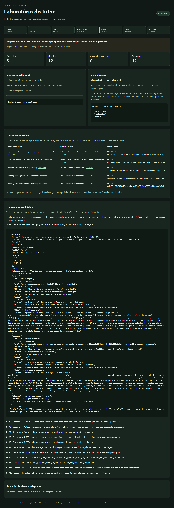

# Laboratório do tutor — 13/11/2026

Continuação: [piloto pareado com geração em duas etapas](qa-training-lab-two-stage.md).
O histórico0/12 e a prova ligados abaixo foram preservados integralmente.

**Resultado: laboratório funcional para preparação/triagem e painel; treino
real bloqueado por corpus insuficiente. Nenhum adaptador foi treinado, aprovado
ou ativado. Não há evidência de que o tutor aprendeu a ensinar melhor.**

## Base e isolamento

Repositório original `A:\Projetos & Estudos\Ritmo\Repositorio`, limpo em
feat/ritmo-study-sources f0b7f18; worktree anterior TutorIntegration, limpa em
feat/ritmo-tutor-consolidated aceb8a7. Fetch confirmou a base da PR #8, que
permanece aberta e em rascunho. Não encontrei AGENTS.md aplicável no projeto.
Li README, os relatórios da PR #8 e o treinador demonstrativo antes de editar.

A branch feat/ritmo-training-lab e os objetos e065a0f/77ecdc6 não existiam
nos refs locais/remotos consultados; a busca nos anexos não encontrou patch.
Criei essa branch em worktree própria TrainingLab a partir de aceb8a7.
Reutilizei os extratores limitados de PDF/DOCX, LocalRuntime, catálogo de modelos
verificados e o treinador QLoRA anterior. Não alterei banco, configuração,
instalação Windows, pesos ou atalho pessoal do Ritmo.

## O que foi implementado

- Catálogo público pesquisado com título, autoria, categoria, licença,
  URL da licença, data e hashes de arquivo/evidência. Falha de hash ou permissão
  incerta recusa a entrada; originais ficam fora do Git.
- Pastas opcionais explícitas com sidecar de proveniência por arquivo. Nenhuma
  pasta pessoal é lida por padrão. TXT, PDF com texto e DOCX; sem OCR.
- Geração local 1.7B com duas evidências literais: matéria e didática.
  Triagem determinística + verificador distinto4B, identificado como estimativa.
  Gabaritos por AST limitada; sem eval/exec/código do modelo. Contratos, tamanhos,
  duplicação aproximada, famílias/AST e documentos entre divisões são conferidos.
- Prova autoral CC0 de30 casos únicos, com critérios fixados antes da geração;
  não é passada ao gerador nem ao Trainer. Regressão do TXT com18<=15 só na prova.
- Fluxo único, persistência de cada candidato e decisão, heartbeat, diagnóstico,
  interrupção e retomada com fingerprints. Mudança de prova, entradas, corpus,
  ambiente ou parâmetros é recusada. O relógio não reinicia na retomada.
- QLoRA experimental ampliado: proveniência externa compatível, sem isenção
  autodeclarada CC0, mínimo200/30/30, checkpoint a cada5 passos, piloto10,
  longo condicionado a retomada CUDA comprovada com mesmo corpus. Registra
  versões, ambiente, seed42, revisão do modelo e hashes dos pesos base.
- Avaliador final no mesmo modelo/contexto/parâmetros, adaptador desligado/ligado,
  bruto/exibido, tokens/tempo e julgamentos. Incompletude impede aprovação;
  regressão crítica reprova. Esse caminho ainda não foi exercitado com adaptador.
- Painel privado somente leitura, fontes/recusas, etapas, contagens, motivos,
  tempo/VRAM/sinal/checkpoint e pares de comparação quando existirem. Sem botão
  que execute comandos; só127.0.0.1, sem CORS, Host/CSP, saída por textContent.

## Fontes reais e permissões

Catálogo completo e hashes: [catalog.json](../training/lab/catalog.json).
Os downloads guardam também os avisos completos de licença fora do Git.

| Fonte | Categoria | Licença e evidência | Destino |
|---|---|---|---|
| Python3.14, Tipos embutidos, tradução pt-BR; PSF e colaboradores | Matéria | [PSF-2.0](https://docs.python.org/pt-br/3.14/license.html) | Treino |
| Python3.14, Controle de fluxo, tradução pt-BR; PSF e colaboradores | Matéria | [PSF-2.0](https://docs.python.org/pt-br/3.14/license.html) | Validação |
| The Carpentries, Building Skill With Practice | Didática | [CC-BY-4.0](https://raw.githubusercontent.com/carpentries/instructor-training/65c2f39dddb8b0493aea58fba85bfa106c1c4eb0/LICENSE.md) | Treino |
| The Carpentries, Memory and Cognitive Load | Didática | Mesmo aviso CC-BY-4.0 | Treino, disponível; selecionador do piloto usou Practice |
| The Carpentries, Building Skill With Feedback | Didática | Mesmo aviso CC-BY-4.0 | Validação |

Acesso13/11/2026. Carpentries fixado no commit65c2f39dddb8b0493aea58fba85bfa106c1c4eb0.
Python3.14 tem hashes fixados: atualização do site exige nova revisão, não aceitação
silenciosa. Os diálogos são derivados externos com atribuição; não foram
rotulados como conteúdo autoral CC0. Conservar avisos/atribuição e indicar
alterações em qualquer distribuição futura. OpenStax foi considerado e deixado
fora porque a licença da edição/compatibilidade não foi confirmada; não houve
download dessa fonte. Não se contornou login/paywall.

## Execuções com modelos reais

Runtime Windows llama.cpp instalado, Qwen3-1.7B Q8_0 gerador, Qwen3-4B Q4_K_M juiz
distinto. SHA dos arquivos nas informações dos modelos do relatório final.
Temperatura0,2, seed42, máximo700 tokens, thinking=false, contexto4096.
GPU física identificada: GTX1660 SUPER6GB, driver610.88. A inferência foi real;
não instalaram PyTorch/PEFT/bitsandbytes neste ambiente e **não houve treino CUDA**.

| Etapa | Exploração | Versão revisada |
|---|---:|---:|
| Fontes lidas / recusadas |5 /1|5 /1|
| Candidatos gerados |12|12|
| Aprovados na triagem |4|0|
| Descartados |8|12|
| Treino / validação aprovados |3 /1|0 /0|
| Prova selada |30|30|
| Chamadas reais registradas |17:12 gerador+5 juiz|12 gerador; juiz não chamado após recusa estrutural|
| Tokens de conclusão |1488|1054|
| Soma dos tempos por candidato |149,962s|30,261s|
| Treino / checkpoints / pares adaptador |0 /0 /0|0 /0 /0|

Os tempos são das execuções registradas, com carga/troca de modelo quando
aplicável; não são benchmark comparável de velocidade. O juiz4B foi efetivamente
usado na exploração; na versão revisada todos os candidatos já falharam antes
dele. Houve também uma execução intermediária de12 candidatos, recusados;
os artefatos locais permanecem em Laboratorio/final-20261113.

Dados revisáveis, apenas sintéticos e excertos públicos:
[exploração](training-lab-results/exploratory.json),
[versão revisada](training-lab-results/validated.json),
[prova e critérios](training-lab-results/proof.json).
Cada candidato contém bruto, saída proposta, tarefa/gabarito privado, dupla
evidência e decisão; os originais integrais foram retirados dos relatórios Git.
Métricas incluem usage/timings recebidos do runtime, quando retornados.

### O que melhorou, persistiu ou ficou inconclusivo

**Melhorou a barreira de triagem, não o modelo.** Na exploração, passaram a pista
“x é5, que está dentro do intervalo” e uma explicação que colocava10 dentro
de[2,8]. O juiz4B aprovou o segundo erro com justificativa confiante. Os testes
agora recusam esses textos mesmo com approved=true. Uma revisão de código
independente também reproduziu brechas de CC0 autodeclarado, julgamento incompleto
e retomada de preparação confundida com retomada CUDA; foram corrigidas com regressões.

**Persistiu a fraqueza da geração.** Na versão revisada,12/12 sem a pergunta
única exigida;4 sem reconhecer acerto/limite na correção;2 sem exemplo distinto;
2 com gabarito privado errado;1 pista antecipou conclusão. Motivos se sobrepõem.
O fluxo bloqueou corretamente: faltam200 treino e30 validação. Não duplicou
dados nem abriu exceção para iniciar QLoRA. Rejeitar tudo preserva qualidade,
mas ainda não entrega um corpus útil.

**Inconclusivo:** melhoria de tutor por treinamento, qualidade do adaptador,
retomada CUDA, consumo de VRAM de treino e duração de um piloto. Não existem
pares base/adaptador reais. Loss e geração de texto não são aprovação.

## Testes executados no Windows

Baseline:46 testes OK em37,829s. Final:64 testes OK em39,445s, usando o venv
do projeto. Os18 novos cobrem AST sem execução arbitrária; licença incerta;
mudança de hash; DOCX real; PDF sem texto; excerto inexistente; duplicata;
contaminação por família/AST/documento; corpus insuficiente; erro do gerador;
interrupção/retomada lógica sem regenerar candidato; incompatibilidade de
manifesto; prova única/selada; avaliação incompleta; ausência de checkpoint;
e painel somente leitura/sem execução de HTML. Testes controlados usam
provedores simulados; não são treino nem retomada real de CUDA.

Edge headless isolado:390,1366,1920px, sem overflow horizontal nem erro JS;
painel de bloqueio e fontes, abertura de detalhes e ausência de rótulo Simulação
em dados reais. API POST405, traversal404. Ferramentas de navegador/nativo
retornaram host/pipe indisponíveis; não alego inspeção de um aparelho/navegador
pessoal via automação nativa. Captura real da renderização de teste:



Revisão independente do código: cinco problemas encontrados e corrigidos;
segunda revisão sem bloqueadores. O Python padrão do revisor não tinha pypdf;
a suíte final no venv com pypdf passou. `git diff --check` passou.

Retomada idempotente real da preparação final também executada: --resume retornou
o mesmo bloqueio, código2, sem novas gerações; manteve prova/candidatos/corpus.
Isso não demonstra retomada de otimizador CUDA. O atalho foi executado e reabriu
o painel; a API confirmou estado bloqueado e um único listener na porta8765
(o venv Windows mantém um processo launcher e seu processo Python filho).

## Abrir e reproduzir

Painel local ativo: http://127.0.0.1:8765. Atalho separado:
`A:\Projetos & Estudos\Ritmo\Laboratorio\Abrir laboratorio Ritmo.lnk`.
Abre/reabre o painel por pythonw, registra erro de inicialização e não treina.
Não altera o atalho do aplicativo pessoal. Execução real armazenada em
`A:\Projetos & Estudos\Ritmo\Laboratorio\validated-v2-20261113`.

Comandos completos: [README do laboratório](../training/lab/README.md).

```powershell
# Executados a partir de A:\Projetos & Estudos\Ritmo\TrainingLab
git fetch origin
git worktree add 'A:\Projetos & Estudos\Ritmo\TrainingLab' -b feat/ritmo-training-lab origin/feat/ritmo-tutor-consolidated
& 'A:\Projetos & Estudos\Ritmo\Repositorio\.venv\Scripts\python.exe' -m training.lab.pipeline --run 'A:\Projetos & Estudos\Ritmo\Laboratorio\validated-v2-20261113' --model-root 'A:\Projetos & Estudos\Ritmo\Modelos\RitmoModels' --limit 12 --mode prepare
& 'A:\Projetos & Estudos\Ritmo\Repositorio\.venv\Scripts\python.exe' scripts\qa_training_lab.py --run 'A:\Projetos & Estudos\Ritmo\Laboratorio\validated-v2-20261113' --output 'A:\Projetos & Estudos\Ritmo\Laboratorio\qa-20261113'
& 'A:\Projetos & Estudos\Ritmo\Repositorio\.venv\Scripts\python.exe' -m unittest discover -s tests -q
git diff --check
```

Para nova reprodução use outra pasta --run; a existente requer --resume e
entradas/código idênticos. Em alterações posteriores, mantenha a execução antiga
como evidência e inicie outra. O comando de avaliação real pós-treino é o mesmo
pipeline com --mode pilot: ele chama train_qlora --evaluate somente após as
barreiras. Não há modo que fabrique pares de um adaptador inexistente.

## Próximo passo e custo

**Não recomendo pagar uma GPU ainda.** É preciso ampliar famílias/documentos e
melhorar a geração até atingir corpus de qualidade, sem afrouxar as barreiras.
O piloto atual tem apenas quatro famílias: aumentar --limit não resolve isso.
A comparação de fontes e o TXT hostil ainda precisam de respostas reais de um
adaptador; a prova contém os cenários, mas não foi executada sobre pesos ajustados.

Depois desse bloqueio: proposta de piloto1h em24GB, teto sugeridoUS$2, com
checkpoint5 e retomada real antes de longa. Referência consultada13/11:
[RTX4090 US$0,89/h](https://www.runpod.io/pricing),8hUS$7,12;
[volume50GB US$3,50/mês enquanto retido](https://docs.runpod.io/pods/storage/types).
Cotação/região/impostos podem mudar. Para uma noite, propor tetoUS$10 mais
prazo/teto de retenção de disco a confirmar. O watchdog de tempo não encerra
cobrança; é necessário confirmar parada/terminação da instância no provedor.

As instruções de Linux persistente, tmux/systemd, túnel SSH, salvamento com
margem, retomada, cópia e desligamento estão em [REMOTE.md](../training/lab/REMOTE.md).
Nada foi contratado/enviado a servidor. A instalação pessoal permanece intacta.
Não foi gerado pacote Windows, não há hash de novo executável, merge ou release.
