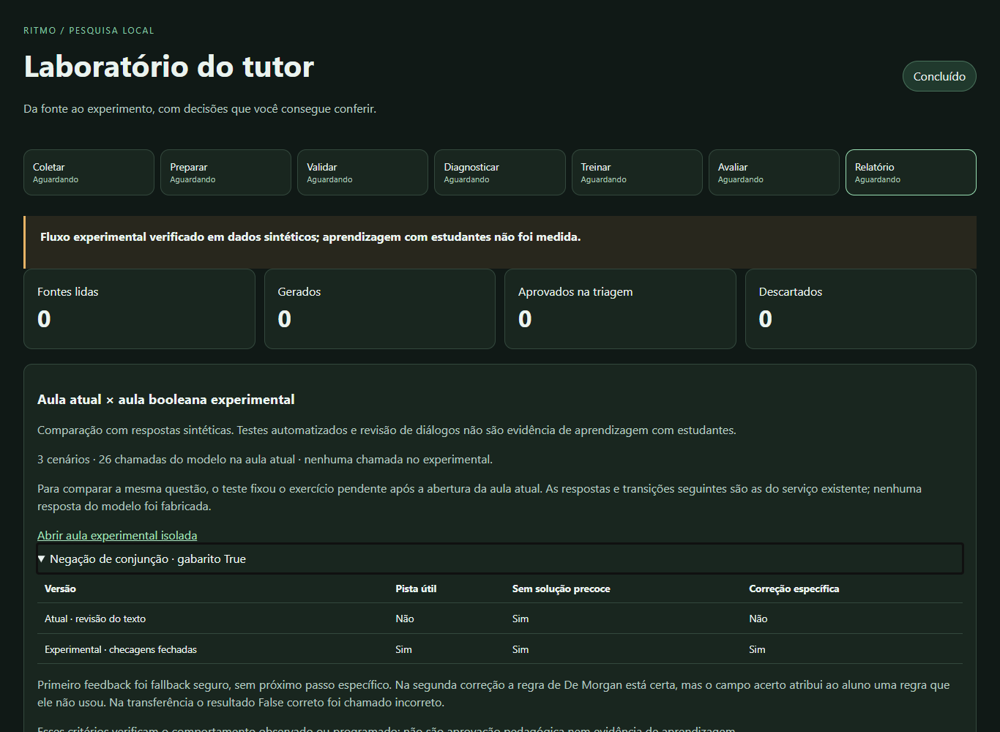

# Aula experimental de Lógica Booleana — PR9

14/11/2026. Continuação de `e957210` na branch `feat/ritmo-training-lab`.
PR9 conferida aberta/em rascunho; checkout inicialmente limpo. Não houve
treino, ampliação de corpus, GPU contratada, cobrança, pacote, instalação,
merge ou release. Todos os dados de comparação são sintéticos.

## Entrega e abertura

Modo experimental integrado às rotas locais do Ritmo, com página própria em
`/boolean-lesson.html` e entrada na área do tutor somente quando habilitado.
`experiments.boolean_lesson` é **false por padrão**, validado como booleano.
Nenhum banco ou configuração pessoal foi habilitado ou migrado.

Instância isolada disponível em [abrir aula](http://127.0.0.1:8771/boolean-lesson.html).
Atalho separado:
`A:\Projetos & Estudos\Ritmo\Laboratorio\Abrir aula booleana experimental.lnk`.
Ele abre o navegador sem terminal, usando somente
`A:\Projetos & Estudos\Ritmo\Laboratorio\BooleanLessonFinal\ritmo.db` e sua
configuração. Duplo clique reaproveita a mesma instância; banco existente sem
marcador de sandbox é recusado, sem alteração. Porta de outro aplicativo é
preservada. O launcher não inicia sensores, câmera, migração ou modelo.

Use **Encerrar instância de teste** para parar o servidor; fechar a aba não
promete encerrá-lo. A aula persiste e pode ser reaberta pelo atalho. Existe
também **Apagar esta aula**, que remove apenas seu registro/diálogo experimental.
A instalação e o atalho pessoais do Ritmo continuam os anteriores.

## Fluxo entregue

Conceito → exemplo curto resolvido → exercício → primeira tentativa → dica
sem resultado → nova tentativa → correção → transferência → devolutiva técnica.

O estado e o diálogo são persistidos em uma tabela separada `boolean_lessons`,
criada **somente ao iniciar explicitamente uma aula habilitada**. Os esquemas,
dados e migrações existentes foram preservados. Ações têm versão otimista e
idempotência; atualização concorrente é recusada sem perder a conversa.
Identificadores públicos de cenários não revelam True/False. Gabaritos, traços
e avaliações intermediárias permanecem privados antes da correção.

O aluno informa uma entrada observada, a expressão usada e a conclusão.
O código verifica a entrada, o resultado da expressão, a conclusão no caso
concreto e a equivalência com a regra em todas as combinações booleanas dessas
variáveis. Não é avaliação de justificativa em português livre.

A dica reutiliza diretamente a referência estruturada de `e957210`, indicando
o subpasso e preservando a pergunta projetada. Não há reescrita por modelo.
A correção é construída dos passos efetivamente enviados:

- reconhece a entrada específica que estava correta;
- distingue consistência com a própria expressão de equivalência com a regra;
- identifica a transformação errada, com contraexemplo quando necessário;
- compara a conclusão com o gabarito e explica a regra/traço calculado;
- retoma o erro da primeira tentativa mesmo quando a segunda o corrigiu.

Não usa apenas “parcial”. Se a conclusão coincide com o gabarito mas a regra
está errada, deixa essa diferença explícita. Se não houver passo certo
verificável, não inventa elogio. Mesmo uma resposta correta na primeira etapa
segue a política experimental de dica e nova tentativa, sem confirmação precoce.

## Cenários

| Cenário | Regra / equívoco | Gabarito principal | Transferência |
|---|---|---:|---|
| Negação de conjunção | `not (cadastro and confirmado)` / distribuir negação mantendo E |True|Alarme com porta/janela; resultadoFalse|
| Implicação material | `not ativo or certificado` / omitir negação do antecedente |False|Política de chuva/capa; resultadoTrue|
| Equivalência | `(a or b) == autorizado` / trocar OU por E |False|Promoção com assinatura/cupom/liberado; resultadoTrue|

As primeiras tentativas usam a transformação equivocada. A segunda mantém o
erro na negação, corrige a implicação e acerta a conclusão por raciocínio ainda
errado na equivalência. As três transferências usam respostas estruturadas
corretas para testar a devolutiva. Pergunta fora de escopo: probabilidade de
chover amanhã. O experimental reconhece que não consegue verificar, não chama
modelo ou internet e não conta a dúvida como tentativa nem troca o exercício.
Expressões não suportadas também não avançam a aula.

Transferência muda contexto e variáveis, mas conserva o padrão algébrico e
fornece a expressão a avaliar. É **transferência próxima**, não demonstração
de aplicação independente de uma regra a partir de uma narrativa nova.

## Referências e limites da fundamentação

Conceitos, subpassos, exemplos e perguntas reutilizam as referências estruturadas
existentes. `tutor/boolean_sources.json` contém os excertos públicos já arquivados:
Python/PSF-2.0 e The Carpentries/CC-BY-4.0, com autoria, URL, licença, acesso,
hash e recorte. O feedback e a prática guiada são adaptações explícitas do Ritmo;
as fontes não prescrevem cada frase nem comprovam sua eficácia com estudantes.
Nenhuma busca nova foi feita. Conteúdo de materiais não é instrução executável.

O interpretador limitado aceita nomes do exercício, booleanos, and/or/not,
igualdade e desigualdade. Não executa Python arbitrário, funções, arquivos ou
comandos. Não envia materiais, notas ou conversas. O modo não acessa memória
pessoal nem infere emoção, capacidade, inteligência ou domínio.

## Comparação observada com a aula atual

Rubrica fixada antes das chamadas:

1. Pista útil: próximo passo vinculado ao erro, não só novo pedido de resultado.
2. Sem solução precoce: não declarar o resultado principal antes da segunda
   tentativa; exemplo resolvido diferente é permitido.
3. Correção fundamentada: acerto específico real, erro exato e regra/valores
   que sustentam a conclusão.
4. Transferência: contexto diferente, regra preservada e gabarito calculável,
   sem declarar aprendizagem automaticamente.

Foram comparados os mesmos três cenários e tentativas. No caminho atual,
`TutorService` e seus prompts/validações permaneceram inalterados. Após a abertura
real, o harness fixa **o mesmo exercício pendente** no estado da aula, pois o
gerador atual poderia escolher outro. Essa intervenção é explícita nos dados;
nenhuma resposta do modelo foi fabricada. As mensagens seguintes seguem as
transições atuais, inclusive a falta de uma etapa dedicada de dica ou transferência.
Não é uma comparação cega nem equivalência de interfaces.

Modelo atual: Qwen3-4B Q4_K_M já instalado, llama.cpp Windows `b11896`, contexto4096,
GPU local99 camadas, temperatura0,3, max_tokens420, thinking=false. Seed42 foi
fixado no provedor de benchmark para reprodução; o runtime normal não a fixa.
**26 chamadas reais** (18 mensagens +8 revisões de formato), todas finish_reason
stop;160,354s somados,71698 tokens de prompt e2727 de conclusão. Tempos excluem
carga do modelo/arquivos. O experimental fez **zero chamadas de modelo**.

Os resultados combinam duas classes de evidência, identificadas no JSON:
verificações automáticas fechadas do experimental e revisão do agente sobre
os textos exibidos pelo caminho atual. Essa revisão não é um juiz validado nem
um experimento com estudantes.

| Caso | Caminho atual observado | Experimental |
|---|---|---|
| Negação, True | Primeira resposta foi fallback sem pista específica. A segunda trouxe regra correta, mas atribuiu ao aluno um acerto que ele não escreveu. Na transferência marcou o False correto como incorreto. |Dica procedural; acerto `cadastro=True` e erro de De Morgan específicos; contraexemplo; transferênciaFalse verificada.|
| Implicação, False | Primeiro feedback afirmou conclusãoTrue apesar de calcular False or False. Atribuiu ao aluno a negação omitida. Segunda resposta foi fallback. |Dica sobre negar antecedente; corrige a tentativa inicial, reconhece a segunda e verifica transferênciaTrue.|
| Equivalência, False | Primeiro feedback inventou troca de `autorizado` para True. Segundo mencionou AND/OR e conclusãoFalse, mas não reconheceu precisamente a entrada observada. Fundamentação/ausência de antecipação não certificadas. |Distingue conclusão coincidente de transformação errada e inconsistência no próprio cálculo; transferênciaTrue verificada.|
| Fora de escopo |Nos três diálogos reconheceu falta de dados meteorológicos. |Recusa verificação de forma determinística, mantendo etapa e contador.|

Na rubrica automatizada de projeto, o experimental cumpriu os três critérios
principais nos três cenários. Isso verifica o comportamento programado; **não
é evidência de que estudantes aprenderam**. No atual não houve pista útil entre
as duas tentativas em3/3 cenários; isso reflete também a política atual de corrigir
logo a primeira tentativa, não apenas uma falha do modelo. Na negação houve
fallback seguro sem solução; na implicação houve conclusão precoce errada; na
equivalência a ausência de antecipação ficou inconclusiva.

## Preservação dos registros e ajuste após revisão

`frozen.json`/`seal.json` foram gravados antes da inferência, com cenários,
rubrica, código e hashes dos23 artefatos anteriores. A prova selada não foi
entrada do modelo ou da aula. A referência0/12,60 brutos, calibração e comparação
estruturada anteriores permanecem byte a byte; TXT hostil continua na prova.

Após revisão independente, o feedback da transferência passou a nomear as
variáveis do contexto novo, em vez das antigas. Os fluxos experimentais foram
reexecutados com as mesmas tentativas, **sem novas chamadas ao modelo**. O
motor original fica em `engine-frozen.py.txt`; avaliações e diálogos originais
ficam em `results-frozen.json`/`experimental_frozen`. O resultado revisado aponta
ambos os hashes e o motivo do ajuste. Não foi alegada validação reservada.

## Testes e diagnóstico Windows

Testes automatizados cobrem flag/rotas desligadas, banco não criado ao recusar,
domínio booleano, dois tipos de erro, gabaritos positivos/negativos, correção
específica, conclusão certa com regra errada, dúvidas sem tentativa, expressão
não suportada, conflitos de versão, idempotência, concorrência, exclusão e
reabertura. O launcher recusa banco existente sem marcador de sandbox.

QA Edge em390,1366,1920px percorreu os três fluxos, reabriu a aula durante a
espera da segunda tentativa, usou teclado e verificou o caso fora do escopo,
sem erro JS/rolagem horizontal. O botão de encerramento e liberação da porta
foram conferidos em instância temporária. Um teste de processo separado criou
um sandbox novo de sua propriedade, confirmou que segundo clique o reutiliza,
encerrou só esse processo pelo endpoint da aplicação (exit0) e confirmou porta
livre. Não controlou aplicativos existentes.

As primeiras suítes completas encontraram falhas intermitentes em telas antigas.
O diagnóstico de dez aberturas capturou `ERR_CONNECTION_REFUSED` em `/api/progress`
com backlog5; consulta redundante da flag foi removida e a fila do servidor local
passou a32. Dez aberturas seguintes não falharam. Outra regressão foi reproduzida
com resposta de salvamento do modo atrasada: ela apagava uma resposta posterior
do tutor. O envio agora aguarda as opções salvas e bloqueia alterações durante
a resposta. O teste controlado falhou antes e passou depois. Uma execução também
expirou esperando a notificação de sensores; o teste isolado passou, sem afrouxar
asserções. Logs dessas falhas continuam arquivados localmente.

Uma tentativa de encerrar/reiniciar a primeira instância persistente por comando
foi rejeitada pela revisão automática de aprovação (“blocked by policy”, sem
motivo adicional). Ela não foi encerrada à força. A versão final foi aberta em
outra pasta/porta (8771). As instâncias iniciais de teste foram preservadas;
se necessário, o botão da página permite encerrá-las por ação explícita do usuário.
Essa recusa é separada dos testes bem-sucedidos com processos novos de QA.

## Comandos

```powershell
Set-Location 'A:\Projetos & Estudos\Ritmo\TrainingLab'
$py = 'A:\Projetos & Estudos\Ritmo\Repositorio\.venv\Scripts\python.exe'
$models = 'A:\Projetos & Estudos\Ritmo\Modelos\RitmoModels'
$run = 'A:\Projetos & Estudos\Ritmo\Laboratorio\boolean-flow-20261114'
$view = 'A:\Projetos & Estudos\Ritmo\Laboratorio\boolean-flow-reviewed-20261114'
git status --short
git rev-parse HEAD
& $py scripts/compare_boolean_lesson.py --run $run --model-root $models --freeze
& $py scripts/compare_boolean_lesson.py --run $run --model-root $models
& $py scripts/report_boolean_lesson.py --run $run --view $view --publish docs/qa/training-lab-boolean-flow
$env:TEMP = 'A:\Projetos & Estudos\Ritmo\Laboratorio\tmp-two-stage'
$env:TMP = $env:TEMP
& $py -m unittest discover -s tests -q
& $py scripts/qa_boolean_lesson.py --output 'A:\Projetos & Estudos\Ritmo\Laboratorio\qa-boolean-flow-final-20261114'
& $py scripts/qa_boolean_launcher.py --output 'A:\Projetos & Estudos\Ritmo\Laboratorio\qa-boolean-launcher-20261114'
& $py scripts/qa_startup_burst.py --output 'A:\Projetos & Estudos\Ritmo\Laboratorio\boolean-flow-20261114\startup-after.json' --runs 10
& $py scripts/open_boolean_lesson.py --run 'A:\Projetos & Estudos\Ritmo\Laboratorio\BooleanLessonFinal' --port 8771
& $py -m training.lab.panel --run $view --port 8768
git diff --check
```

Use diretórios novos para reproduzir; o benchmark não sobrescreve execuções.
O relatório preserva o motor congelado usado na rodada e registra o replay de
clareza posterior. O benchmark real e o painel foram iniciados com
`Start-Process -WindowStyle Hidden`/pythonw, stdout/stderr nas pastas isoladas.
Nenhum processo de inferência ficou ativo. Não houve estudo com pessoas,
mensuração de retenção, comparação estatística ou aprovação pedagógica geral.

Para uma nova reprodução, use outras pastas e copie o motor **antes** de rodar
o benchmark. Isso permite preservar tanto o código usado quanto revisões futuras:

```powershell
Copy-Item tutor/boolean_lesson.py "$run/engine-frozen.py.txt"
# Em uma pasta nova para publicação, depois da execução:
& $py scripts/report_boolean_lesson.py --run $run --view $view --publish "$run/artifacts" --frozen-engine "$run/engine-frozen.py.txt"
```

Resultado final da suíte: **100 testes OK em185,792s**, sem skips, incluindo a
regressão controlada da resposta atrasada do modo. `compileall` e `git diff
--check` também passaram. As execuções com falhas anteriores não foram apagadas
nem suas asserções reduzidas. O arquivo de diagnóstico registra 1/10 aberturas
com erro antes do ajuste de fila e 0/10 após.

O painel foi validado também em390,1366,1920px: **81 mensagens completas**, seis
colunas de diálogo, nenhuma rolagem horizontal/erro JS e estado dos detalhes
preservado após atualização. Os diálogos de comparação não são os dados da
instância interativa; ambos usam bancos isolados diferentes.

A revisão final também conferiu o caminho de iniciar aula pelo leitor: ele usa
a mesma fila de salvamento do tutor e recusa troca de contexto durante resposta.
Essa correção de interface não altera os prompts ou textos da comparação real.
Após esse último ajuste, os cinco testes de navegador do tutor e da corrida
controlada passaram novamente em21,905s. A suíte integral de100 testes havia
passado em185,792s; a verificação posterior foi focada no código de UI alterado.

[QA da aula](training-lab-boolean-flow/browser-qa.json) ·
[QA do launcher](training-lab-boolean-flow/launcher-qa.json) ·
[QA do painel](training-lab-boolean-flow/panel-qa.json) ·
[Abertura antes](training-lab-boolean-flow/startup-before.json) ·
[Abertura depois](training-lab-boolean-flow/startup-after.json).



[Diálogos e avaliação revisados](training-lab-boolean-flow/results.json) ·
[Diálogos congelados](training-lab-boolean-flow/results-frozen.json) ·
[Chamadas reais](training-lab-boolean-flow/calls.jsonl) ·
[Painel com diálogos completos](http://127.0.0.1:8768) ·
[Abrir aula isolada](http://127.0.0.1:8771/boolean-lesson.html).
